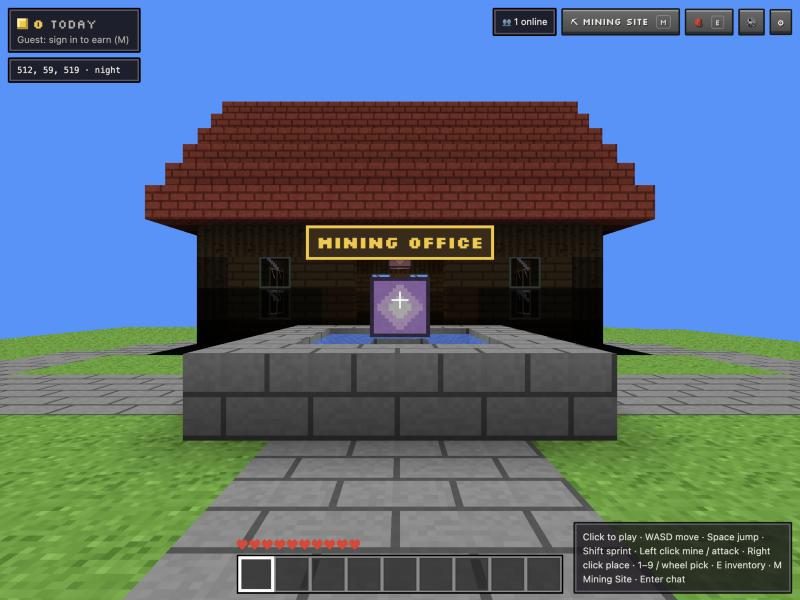
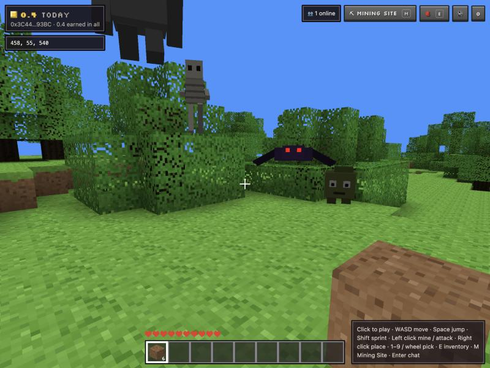

# MineWorldCraft

A shared block world in the browser: mine, fight monsters, build, and earn **$MINE** on Robinhood Chain. Version one.

Everything is original: the code, the block textures (drawn pixel by pixel in `web/textures.js`), the creatures, the
miner outfits and the town. No Minecraft code, textures, sounds or names are used, and the game says it isn't
affiliated with Mojang or Microsoft. Built on what worked in Courier World
([github.com/AdamNakamoto/courierworld](https://github.com/AdamNakamoto/courierworld)): plain HTML/JS with three.js,
a Cloudflare Worker for the shared world, Foundry contracts reusing Courier's audited hook, NFT and voucher code.




## Layout

- `web/`: the site (no build step; three.js and viem load from esm.sh). Set the hosting root to `web`.
- `multiplayer/`: the world server, a Cloudflare Worker with one Durable Object.
- `contracts/`: Foundry project (`git submodule update --init --recursive`).
- `dev.sh`: a local chain, the contracts and the site.
- `docs/DESIGN.md`: the design the three parts share.

## Run it locally

```bash
./dev.sh
```

Starts Anvil on port 8610, deploys $MINE, MiningSites and the Miners, gives the dev players (Anvil accounts 2-9) some
$MINE and two revealed Miners each, writes `web/chain.json` and `multiplayer/.dev.vars`, and serves the site at
http://localhost:5810. Then, once it prints "Game", start the local world server (it reads `.dev.vars` when it starts,
so start it after `dev.sh`, and restart it whenever `dev.sh` restarts):

```bash
cd multiplayer && npm install && npx wrangler dev --port 8790
```

On localhost the game joins the local server automatically (`web/config.js`); `?mp=` with nothing plays offline, and
`?t=0.25` fixes the sky at noon (localhost only). `./dev.sh --fork` runs the full launch on a fork of Robinhood Chain
(the real PoolManager, IMD and IMD/ETH pool), so the panel's trade box works with play money. `--wallet` logs in with
your own browser wallet on a practice chain (chain ID 466400); `--sale` leaves the Miners mint open and sealed.

## How to play

WASD to move, Space to jump, Shift to sprint, the mouse to look. Hold the left button to mine (or attack), right
click to place the block in your hand, 1-9 or the wheel to pick, **E** for the inventory and crafting, **M** for the
Mining Site panel, Enter to chat. Phones get a stick, look-by-drag, and mine / place / jump buttons.

Punch a tree for logs, craft planks and sticks, then a wooden pickaxe; stone needs a pickaxe, iron ore a stone one,
gold, diamonds and $MINE crystals an iron one. Monsters (Mudlings, Cave crawlers, Bone rattlers, Rock golems) come out
at night and underground. The town in the middle is protected: nobody mines or builds there.

## The economy

| | |
|---|---|
| $MINE | 1,000,000,000, fixed, minted once. ERC-20 with permit; no owner, no mint, no transfer tax |
| Liquidity | 50% (500M) locked forever, single-sided, in one $MINE/IMD Uniswap v4 pool |
| Mining vault | 50% (500M) in `MiningSites`, paid out only for what players earn in the game |
| Trading fee | Every swap pays 4% of its IMD side to `0x6e85Dc9f094b7DD35a2A981AbBd0AC9C496670eD` (taken by the pool's hook; the hook is renounced at launch, so only that wallet can ever move its own fee) |
| Mining site | Opened once per wallet with ETH (0.005 at launch), paid to the treasury. Needed to convert earnings to $MINE |
| Miners NFT | 999 cosmetic outfits in 16 designs, blind mint (0.004 ETH) to the treasury, revealed after the mint. 5% royalty, enforced |
| No yield farming | Nothing pays for holding or waiting. $MINE comes only from playing |

**Earning.** Signing in with a wallet (one free signature) makes the world server count that wallet's earnings:
breaking natural blocks and defeating monsters, at the rates in `web/rewards.js` (stone 0.5, coal 3, iron 8, gold 20,
diamond 60, a $MINE crystal 150; monsters 6-25). Blocks players placed pay nothing. A wallet earns up to 3,000 $MINE a
UTC day. To add an activity or change a rate, edit `web/rewards.js` and deploy the server and the site.

**Checks.** The server runs the same world generator as the game (`web/worldgen.js`), so it knows what every block
was. It pays for a break only if the block is really there, within reach of where the player really is, outside the
town, and not faster than the best pickaxe allows; monsters are spawned by the server, and hits come no faster and no
harder than the best sword's. A player who moves faster than anyone can earns nothing for a while.

**Converting.** With a mining site open, **Convert to $MINE** asks the server for a voucher for the wallet's lifetime
total and `MiningSites.claim` pays the difference from what it has paid before, within a per-wallet daily cap (5,000)
and a global one (1,000,000); the owner can change both up to hard limits (100,000 and 5,000,000) and pause claims. A
leaked server key can take at most the daily caps until it's paused and replaced.

## Contracts

| | |
|---|---|
| `MineToken.sol` | $MINE: 500M to the hook (pool), 500M to MiningSites (vault) at deploy |
| `MineHook.sol`, `MineRouter.sol`, `MineEthRouter.sol` | Courier's audited `StampHook` and routers for $MINE: one pool, locked launch liquidity, 4% fee on the IMD side, buy/sell with IMD or ETH. Differences from StampHook: launch supply up to 1B, lowest start tick -300,000 (as CourierPad), market cap over the fixed supply |
| `MiningSites.sol` | Mining sites (ETH, once per wallet) and the vault's claims: EIP-712 vouchers from the world server, daily caps, pause. Ownable2Step, can't be renounced |
| `MineWorldMiners.sol` | Courier Skins adapted: 999 Miners, commit-reveal, on-chain metadata with pictures under an owner-settable base, enforced 5% royalty (ERC721-C, OpenSea's registry). The owner can update the website and social links shown on OpenSea at any time (`setLinks`) |

```bash
cd contracts
forge test                                  # unit + invariant tests
forge test --fork-url robinhood             # plus the fork tests against Robinhood Chain
./script/deploy-mainnet.sh launch           # dry run of the launch on a fork
./script/deploy-mainnet.sh miners           # dry run of the Miners
```

Settings are in `contracts/launch.env` (public values only). The real launch, after an audit:

1. Generate the server's voucher key straight into the Worker (never print it) and note its address:
   `npx wrangler secret put MINING_KEY` in `multiplayer/`.
2. `MINING_SIGNER=<that address> ./script/deploy-mainnet.sh launch --broadcast --browser --browser-disable-open`
   (sign at http://127.0.0.1:9545 with the wallet on Robinhood Chain; it becomes the owner of MiningSites).
3. `./script/deploy-mainnet.sh miners --broadcast --browser --browser-disable-open` (the reveal secret goes to
   `~/mineworldcraft-miners-reveal-secret.txt`, never printed; keep it safe). Then put the pictures
   (`web/miners/`) at `MINERS_IMAGES`.
4. Set `CHAIN_ID`, `CHAIN_RPC`, `MINING_ADDRESS` and `MINERS_ADDRESS` in `multiplayer/wrangler.toml`, deploy the
   Worker, put its address in `web/config.js` (`LIVE_ROOM`) and its domain in the Worker's `ORIGINS`, and publish the
   site with `web/deployments/robinhood.json` (written by `export-web.sh`).
5. On OpenSea: set the collection's links (or call `setLinks`) and turn on creator earnings.

## The world server

```bash
cd multiplayer
npx wrangler deploy
```

One Durable Object holds the world: who's playing, every edit (per chunk), the monsters, chat and the $MINE ledger
(16 shards). The terrain itself is never stored: both sides generate it from the same seed. Built for Cloudflare's
free plan: hibernating WebSockets, pings answered without waking the room, positions sent only while moving, writes
batched every 30 seconds (the free plan allows 100,000 requests and 100,000 written rows a day per account, shared by
every Worker on it, so a separate Cloudflare account keeps Courier World's room unaffected).
