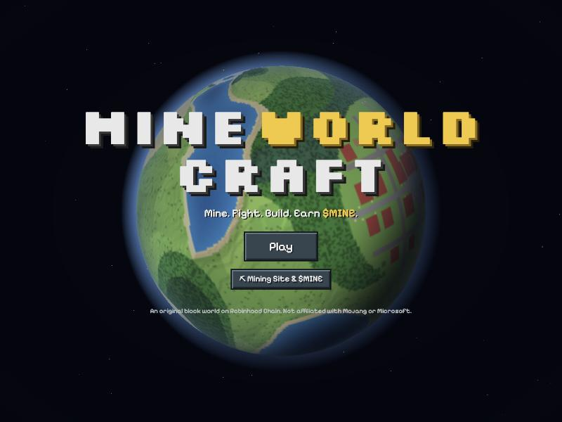
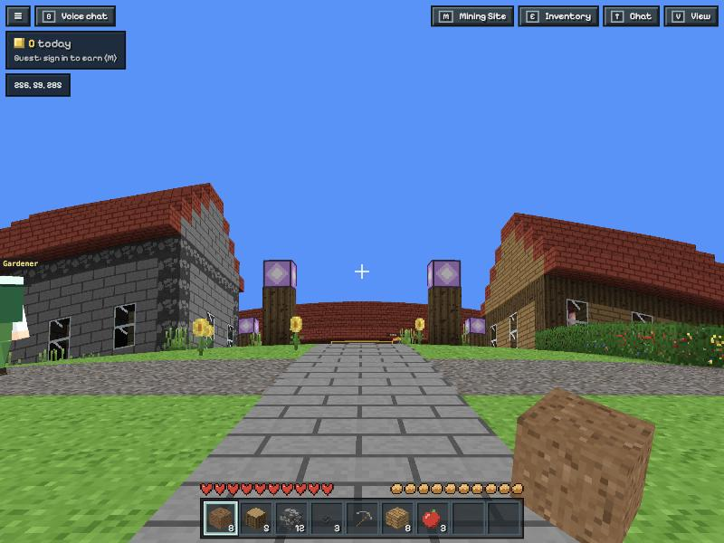
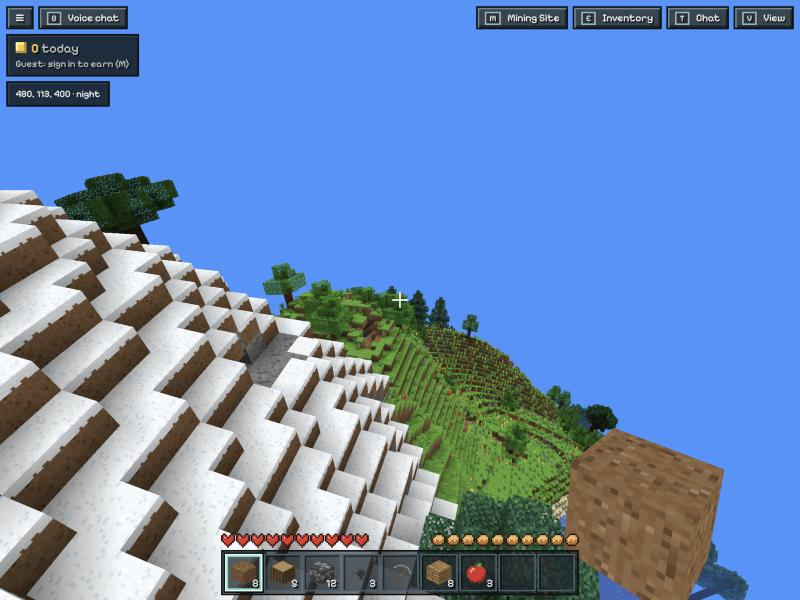

# MineWorldCraft

A tiny round planet of blocks in the browser: mine, fight monsters, build, meet the villagers, and earn **$MINE** on
Robinhood Chain.

Everything is original: the code, the block textures (drawn pixel by pixel in `web/textures.js`), the creatures, the
I'M DIO characters and the town. No Minecraft code, textures, sounds or names are used, and the game says it isn't
affiliated with Mojang or Microsoft. Built on what worked in Courier World
([github.com/AdamNakamoto/courierworld](https://github.com/AdamNakamoto/courierworld)): plain HTML/JS with three.js,
a Cloudflare Worker for the shared world, Foundry contracts reusing Courier's audited hook, NFT and voucher code.





## Layout

- `web/`: the site (no build step; three.js and viem load from esm.sh). Set the hosting root to `web`.
- `multiplayer/`: the world server, a Cloudflare Worker with one Durable Object.
- `contracts/`: Foundry project (`git submodule update --init --recursive`).
- `dev.sh`: a local chain, the contracts and the site.
- `docs/DESIGN.md`: the design the three parts share.

## Run it locally

```bash
./dev.sh
```

Starts Anvil on port 8610, deploys $MINE, its vault, MiningSites, MinePayments, I'M DIO and CrafterLevels, gives the
dev players (Anvil accounts 2-9) 1,000,000 play $MINE (from a stand-in for the pool's half: there's no pool, so no
trade box, on a plain local chain) and two revealed DIOs each, writes `web/chain.json` and `multiplayer/.dev.vars`,
and serves the site at
http://localhost:5810. Then, once it prints "Game", start the local world server (it reads `.dev.vars` when it starts,
so start it after `dev.sh`, and restart it whenever `dev.sh` restarts):

```bash
cd multiplayer && npm install && npx wrangler dev --port 8790
```

On localhost the game joins the local server automatically (`web/config.js`); `?mp=` with nothing plays offline, and
`?t=0.25` fixes the time of day at noon (localhost only: the sky and the villagers' hours). `./dev.sh --fork` runs the full launch on a fork of Robinhood Chain
(the real PoolManager, IMD and IMD/ETH pool), so the panel's trade box works with play money. `--wallet` logs in with
your own browser wallet on a practice chain (chain ID 466400); `--sale` leaves the I'M DIO mint open and sealed. A fork
reads Robinhood Chain's official RPC; where a network's DNS blocks that name (Anvil then reports a certificate error),
run `python3 tools/rpc-relay.py` and fork through it: `FORK_URL=http://127.0.0.1:8611 ./dev.sh --fork`.

## How to play

WASD to move, Space to jump, Ctrl (or W twice quickly) to sprint, Shift to sneak (you won't walk off an edge), the
mouse to look. Moving feels like Minecraft Java: the same 20 ticks a second and the same speeds and jump
(`web/physics.js`), view bobbing (it can be turned off in the menu) and its animations for every miner
(`web/avatar.js`). Hold the left button to mine (or attack, or click a villager to talk), right click to place the
block in your hand or hold it to eat, 1-9 or the wheel to pick, **E** the inventory and crafting, **M** the Mining
Site panel, **V** to see your miner from outside, **B** voice chat, **T** or Enter to chat, **F** the rocket (on its
pad), **Esc** the menu (your name, voice, settings). Phones get a stick (push it all the way to sprint),
look-by-drag, and mine / place / jump buttons. Chat commands: `/wild` (a safe random spot far from spawn), `/spawn`,
`/sethome` and `/home`, `/help`; on a zone they work within it (`/spawn` is its landing pad, `/home` only where it was set).

Punch a tree for logs, craft planks and sticks, then a wooden pickaxe; stone needs a pickaxe, iron ore a stone one,
gold, diamonds and $MINE crystals an iron one. Monsters (Mudlings, Cave crawlers, Bone rattlers, Rock golems) come out
at night and underground. Food keeps you going: the hunger bar drains as you move, mine and fight; apples drop from
leaves, berries from bushes, and a red and a brown mushroom with a plank make stew. A full belly heals you, an empty one
hurts, and you need food to sprint (`web/vitals.js`).

The Smithy's shop (**H**, or Garrick the armorer at the Smithy's door; `web/shop.js`) sells tools for mining (up to the
Crystal pickaxe, the fastest), weapons (up to the Crystal sword and the slow, heavy war hammer) and armor: helmet,
chestplate, leggings and boots in Padded, Iron, Diamond and Crystal. Armor takes a share of monsters' hits (a full
Diamond set, 20 points, takes two thirds), shows as a row over the hearts and on your miner for everyone to see; click
a piece in the inventory to wear it. Prices are in $MINE (from 5 for torches or apples and 8 for padded boots to 3,950
for the war hammer; the best full kit is 21,025), paid on-chain: **Buy** approves exactly the price for MinePayments and
pays it (the "shop" kind: 75% burned, 25% to the project treasury), and once the receipt shows that payment the items go
into the inventory. Inventories live in the browser, so the game checks the receipt itself and remembers every payment
that delivered, so one payment never adds items twice; an order cut short after paying (a reload) is delivered the next
time the shop opens. Buying needs a logged-in wallet with enough $MINE (the shop shows the balance). `FREE_WHILE_TESTING`
in `web/shop.js` makes it all free again.

Tools, weapons and armor wear out, with the classic block games' numbers (`maxDurability` in `web/blocks.js`): wood 59
uses, stone 131, iron 250, diamond 1,561, crystal 2,031, the war hammer 1,200; armor by piece and tier (an iron
chestplate 240, a diamond one 528). A pickaxe wears 1 for each block it breaks (none for blocks that break instantly)
and 2 for each hit; a sword 1 for each hit and 2 for each block; each worn piece of armor a quarter of every monster's
hit (at least 1). A bar under the icon shows what's left (hover for the count), and at zero the item breaks. Two worn
copies of the same item combine into one at the top of the crafting list: their uses left, plus 5% of a new one's.

## The planet

The world is a tiny planet, as in Courier World: 512 blocks round in every direction, with no edge (walk any way and
you come back where you started). The blocks stay square and physics stays flat, but everything is drawn bent round a
sphere of radius 512 / 2π, about 81.5 blocks, as seen from the camera (`web/planet.js`; the chunks bend in their
shader, everything else is placed each frame), so the horizon curves close by and mountains fall away behind it. The
title screen shows the whole planet as a turning globe (`web/globe.js`, from a map the world worker draws). The terrain
(`web/worldgen.js`) tiles seamlessly: plains, forests, flower meadows, dark forests of giant trees, pine taiga, deserts,
snow, peaks, seas and beaches, caves and ores; `tools/check-worldgen.mjs` checks that the game and the server agree on
every block, across the seams too. Chunks are generated and meshed in a Web Worker (`web/world-worker.js`); the view
reaches up to 15 chunks.

## The town and its villagers

The town at the top of the planet (`web/town.js`) is protected: nobody mines or builds within 64 blocks of the
fountain (the first try explains, and offers `/wild`). Stone main roads and gravel lanes, the plaza and Mining Sites
(the office), a bakery, smithy, library, trading post, two-storey tavern, barn, town hall, clock tower and watchtower,
eleven houses, a flower garden, a pond, an orchard and gates. Fourteen villagers (`web/villagers.js`) live in the
houses, work in the shops and walk the roads to the plaza, the garden and the pond, then go home at dusk; where each
one is follows the clock alone, so every player sees them in the same place with nothing sent over the network. Click
one to talk: they know the game.

## The rocket and its zones

A rocket stands on the launch pad in the town's north-east (`web/town.js` `LAUNCH`, on open grass between the north road,
the lane and the clock tower). Click it, or stand on the pad and press **F**, for the destination card; it lifts off,
the screen fades to the destination turning in space, and you land on its pad (`web/rocket.js`). **Tickets:** one
ticket per trip out (home to a zone, or a zone to another), with no time limit; the way home is always free, and from
home the next trip out needs a new one. The world server remembers each wallet's zone, so a reload or a dropped
connection lands you back there. A ticket costs the zone's `ticket` in $MINE, paid in full to the treasury: Deepvein
and Cinderfall 2,100 each, Red Mesa 210. Sign in, then **Buy ticket** on the rocket's card: the game approves exactly
the price for MinePayments and pays it (the "ticket" kind), and hands the world server the transaction; the server
reads its receipt and keeps the ticket for the wallet if the payment succeeded, came from that signed-in wallet, was a
ticket of at least that zone's price, is at most 3 hours old and never bought a ticket before. The card then says how
many you have there; the next trip out there uses one. Guests can't fly out. `TICKETS_FREE` in `web/zones.js` makes
every trip free again. Every zone is its own 512-block planet, bent like home, from its
own seed (`web/zonegen.js`); its landing pad (the middle of the planet) is protected for 20 blocks: no mining, building or
fighting there. Everything tunable is in `web/zones.js`; what the zones pay is in `web/rewards.js` (`ZONE_PAY`, `BOSS_POOL`).

| Zone | | |
|---|---|---|
| Home planet | No PvP | The town and its villagers |
| **Deepvein**, the 2x Mine Zone | No PvP | Rocky crags riddled with caves, stone over harder deep rock (1.5x stone's breaking time), glowcaps on cave floors, rare ores three times as common (iron 2x, coal 1.5x). Everything earned pays **2x** (blocks and monsters), within the usual 300 a wallet (more with a cap boost) and 35,000 a day for everyone. Monsters come day and night, up to 5 at once, about every 10 s, with 1.5x health and damage. Its edits are kept a week at a time: every Monday 00:00 UTC it grows back |
| **Cinderfall**, the Boss Zone | No PvP | Ash plains, basalt, volcanoes with glowing craters, cracks of fire and ember-tipped spires. A stone-brick path runs north from the pad to the arena, where **Ashgrim, the Cinder Colossus** (an original giant of cooled lava with a molten heart, 1,500 HP) fights everyone at once |
| **Red Mesa**, the PvP Zone | PvP off the pad | Terraced mesas in banded clays over red sand, dry riverbeds and cacti. Players can hit each other; a player beaten here drops everything they carry |

**The boss.** The world server keeps its health and picks its moves; every game animates each move from its start time,
so all see the same thing and nothing is sent while it moves. It walks towards someone, **slams** both fists (a red ring
on the ground shows the reach: step out before they land), **throws a molten rock** at where someone stands (an orange
ring marks it: move off it), and once it's under 60% it **calls up monsters** beside it. The server checks every hit on it
(no faster than a sword, at most the war hammer's 9, from within reach of where it is). Beaten, it pays 150 $MINE (`BOSS_POOL`) shared
by the signed-in players who hit it, by the damage each did (each share with its player's earn boost, through the ledger
and its caps), plus diamonds, gold, iron
and $MINE crystals for everyone who did 5% or more (more, and maybe a Crystal sword, for the top hitter); it's back 10
minutes later. Left alone it heals.

**PvP.** Only in Red Mesa, never on its pad, and nowhere else (the zone's `pvp` flag; elsewhere other players can't even
be aimed at). The server checks each hit (both in the zone, off the pad, within reach, no faster than a swing, at most 9
damage, not just after landing) and passes it to the one hit, whose game takes off its armor's share and wear. A player
beaten there leaves everything they carried (inventory and armor, with wear) in a loot chest where they fell; the server
keeps it 3 minutes and hands it, once, to the first player close enough to open it. Inventories live in the browser, so
the chest holds what the beaten player's game reports (cleaned up by the server); a chest is only made right after a
checked hit from the named player, once per knock-out.

## Players

Other players walk the planet with you, with name tags and the DIO they wear. After signing in (Mining Site panel),
pick a name in the menu: 3 to 15 letters, numbers or `_`, first come first served, changed at most once a day; reserved
and offensive names are refused (`web/name-rules.js`, from Courier World; add one to `BANNED` to take it down). Chat
lines (no links or wallet addresses) and who joined or left show in the chat box; clicking a name mutes that player.

Voice chat (`web/voice.js`) is off until a player turns it on (B, or the menu). Players with voice on who stand within
about 32 blocks talk directly, browser to browser (WebRTC); the world server only passes on the messages that set a
connection up, and only between nearby players who both have voice on. Voices fade with distance. It uses public STUN
servers only, so players behind strict networks may not connect until a TURN relay is added.

## The economy

| | |
|---|---|
| $MINE | 21,000,000 in all, the same as Courier World's $STAMP. ERC-20 with permit, no transfer tax |
| Liquidity | 50% (10,500,000) locked forever, single-sided, in one $MINE/IMD Uniswap v4 pool at launch |
| Mining vault | 50% (10,500,000), minted by `MineVault` only as players convert what they earn in the game: at most 35,000 a day, whatever the rules contract asks, so it lasts at least 300 days (longer still: earnings a site's rate doesn't convert are never minted) |
| Trading fee | Every swap pays 4% of its IMD side to `0x6e85Dc9f094b7DD35a2A981AbBd0AC9C496670eD` (taken by the pool's hook; the hook is renounced at launch: after the renounce only the current fee recipient can move the fees; nobody else can) |
| Mining site | Opened once per wallet with ETH (0.005 at launch), paid to the treasury. Needed to convert earnings to $MINE. A new site is level 1 and converts 50% of what it earns; upgrades raise it to 60%, 70%, 85% and 100% at levels 2 to 5, for 4,620, 18,942, 77,662 and 318,415 $MINE (about $1,000 for all four at a $50,000 market cap) |
| DIO levels | Every DIO starts at level 1; its holder raises it to level 5 for 2,310, 9,471, 38,831 and 159,207 $MINE (half a site's). The level stays with the DIO when it's sold, shows as its "Level" trait, and adds to its boost (below) |
| Shop and tickets | Paid in $MINE through `MinePayments` at the game's prices (`web/shop.js` `CATALOG`, `web/zones.js` `ticket`): the shop's 75% burned and 25% to the treasury; rocket tickets (2,100 for Deepvein or Cinderfall, 210 for Red Mesa) all to the treasury |
| Burns | Site upgrades and DIO levels burn 75% of what they cost and send 25% to the treasury, as the shop does. The token counts every mint against its 21M cap, so a burn is for good: the supply only ever shrinks from what was minted |
| NFT: I'M DIO | "I'M DIO" (symbol DIO; the contract is `MineWorldCrafters`): 3,333 pixel-art characters, drawn and stored entirely on chain, no two alike. The one a player wears is how their miner looks, and boosts their mining by its rarity and level (below). Free blind mint (5 a transaction, 10 a wallet; the owner can set a price, paid straight to the treasury), then revealed: the owner publishes the secret committed at deploy, and the seed waits for the next block's hash, which anyone then locks in (`seal`), so nobody can pick looks or see them before everyone else. 5% royalty, enforced through the transfer validator the owner picks (it can relax that, in public) |
| Owner and treasury | `0x6e85Dc9f094b7DD35a2A981AbBd0AC9C496670eD` owns the vault, the three upgradeable contracts and I'M DIO, and is the treasury (site sales, the unburned share of upgrades and payments, tickets, any mint price, the royalty) and the fee recipient. Ownership moves in two steps and can't be renounced; it can be handed to a multisig or a timelock. A treasury must take ETH where ETH is sent to it (MiningSites and I'M DIO refuse one that doesn't) |
| No yield farming | Nothing pays for holding or waiting. $MINE comes only from playing; NFT boosts only add to what a player does |

**What can change and what can't.** Fixed forever: the token (21M cap, no owner, no proxy, no pause, no blocklist, no
transfer tax), the mining vault (35,000 a day and 10,500,000 in all, not upgradeable; its distributor can only be
replaced in the open, two days after it's proposed, and only by a contract the vault's owner owns that carries the
players' books over), the pool's locked
liquidity and its 4% fee (the hook is renounced: after the renounce only the current fee recipient can move the fees;
nobody else can), and I'M DIO's art, rarities and 5% royalty rate. The royalty's enforcement is only as strict as
the transfer validator: the owner can relax it, plainly (point the collection at a validator that allows everything,
or loosen the collection's policy on OpenSea's registry), and either change shows on chain.
Upgradeable by the owner (UUPS proxies, every site,
level and total kept across upgrades): `MiningSites` (site price, upgrade costs, rates, burn share, more levels up to
20, the daily caps, the voucher key, pause), `CrafterLevels` (costs, burn share, more levels) and `MinePayments` (each
kind's burn share, new kinds). Whatever runs in them, nobody can mint more than the vault allows: the most an owner or
a leaked server key could take is the vault's 35,000 a day.

**Earning.** Signing in with a wallet (one free signature) makes the world server count that wallet's earnings:
breaking natural blocks and defeating monsters, at the rates in `web/rewards.js` (grass, dirt and sand 0.01; stone and
logs 0.05; coal 0.3, iron 0.8, gold 2, diamond 6, a $MINE crystal 15; monsters 0.6 to 2.5; Deepvein pays 2x). Blocks
players placed pay nothing. A wallet earns up to 300 $MINE a UTC day before boosts (times a zone's `capMul` in
`web/zones.js`, 1 everywhere for now), and everyone together at most 35,000 a day, boosts or not. The ledger counts
ten-thousandths of a $MINE, so a percentage boost on a 0.01 block is kept exactly. To add an activity or change a rate,
edit `web/rewards.js` and deploy the server and the site.

**NFT boosts.** Every NFT a player uses can boost their mining while they play (`web/boosts.js`, shared by the game and
the server; nothing pays for holding). One item per slot, and the slots add up: **speed** (blocks break that much faster;
the server allows for it in its break-rate check), **earn** (more $MINE for every block, monster and boss share),
**cap** (a higher daily cap) and **move** (faster walking, for the vehicles to come). Totals are capped at +150% speed,
+150% earn, +300% cap and +100% move. Today the **DIO** slot (I'M DIO) is live: its rarity gives Common +5% speed, +5% earn,
+10% cap; Rare +10/+10/+25; Legendary +20/+20/+50; its level (bought on-chain from CrafterLevels) adds L2 +5/+5/+10,
L3 +15/+15/+30, L4 +30/+30/+60, L5 +50/+50/+100. Skins, companions, auras and vehicles have their slots and placeholder
tables waiting (contract `null`, "Coming soon" in the panel); the top of `web/boosts.js` says how to plug a collection
in. The server reads what a player owns when they sign in, wear or equip (`ownerOf`, the DIO's rarity from its
seed, `levelOf`; a level it can't read counts as 1 and is read again a minute later), checks again every 10 minutes
while they earn, and tells the game; the Mining Site panel (M) and a line under the HUD's earnings show it.

**Checks.** The server runs the same world generator as the game (`web/worldgen.js`), so it knows what every block
was. It pays for a break only if the block is really there, within reach of where the player really is, outside the
town, and not faster than the best pickaxe allows; monsters are spawned by the server, and hits come no faster and no
harder than the best sword's. A player who moves faster than anyone can earns nothing for a while.

**Converting.** With a mining site open, **Convert to $MINE** asks the server for a voucher for the wallet's lifetime
total (in wei) and `MiningSites.claim` converts the earnings it hasn't converted before at the site's rate (50% at level
1, up to 100% at level 5) at the moment it claims, so an upgrade before claiming converts everything still unclaimed at
the better rate. It pays within a per-wallet daily cap (1,500 $MINE at launch, at most 3,500) and one across everyone
(35,000, the vault's daily limit); the owner can change the caps and pause claims. The panel shows both what you earned
and what you'll receive. A leaked server key can take at most the daily caps until it's paused and replaced.

**Upgrading.** The Mining Site panel (M) shows your site's level and rate, the next level's rate and cost, and an
**Upgrade to level N** button: it approves exactly that cost for MiningSites, then calls `upgradeSite(cost, rate)` with
the cost and the new level's rate it showed (75% burned, 25% to the treasury), and the claim box shows the new rate at
once. Under I'M DIO, **Levels** lists each DIO you hold with its rarity, level, boost, and the next level's cost and
boost; **Level up** approves exactly the cost for CrafterLevels, then calls `upgrade(tokenId, cost)`. If it's the DIO
you wear, the game asks the world
server to read it again at once (`["recheck"]`), so the new boost counts within seconds. Every $MINE payment in the game
approves exactly what it costs, never more, and every upgrade names the cost it was shown as the most it will pay
(`maxCost`; a site upgrade also the rate it was shown as the least it buys, `minRateBps`), so a price raised or a rate
cut meanwhile makes it fail (`CostAboveMax`, `RateBelowMin`) instead of charging for less, even from a wallet that
approved more. Short of $MINE? Buy some in the panel's trade box.

## Contracts

| | |
|---|---|
| `MineToken.sol` | $MINE: Courier World's $STAMP (StampToken) line for line. ERC-20 with permit and burn, 21M cap counting every mint (so burns are for good), 10.5M to the hook (pool) at launch, the rest minted only by its one minter, the vault (set once). Renounced at deploy: no owner, no proxy, no pause, no tax |
| `MineVault.sol` | The mining vault, $MINE's minter: mints straight to players when its distributor (MiningSites) asks, never more than 35,000 in a UTC day nor 10,500,000 in all. Not upgradeable. The owner can replace the distributor only in the open (`proposeDistributor`, then `acceptDistributor` two days later), and only with a contract whose `owner()` is the vault's owner, `vault()` the vault and `predecessor()` the current distributor: propose the new proxy's predicted address, deploy it with `initialize` in its constructor, then accept (the steps are in its NatSpec) |
| `MineHook.sol`, `MineRouter.sol`, `MineEthRouter.sol` | Courier's audited `StampHook` and routers for $MINE: one pool, locked launch liquidity, 4% fee on the IMD side, buy/sell with IMD or ETH. The one difference from StampHook: the lowest start tick is -300,000 (was -400,000, as CourierPad); everything else, the 21M launch limit and the market-cap maths included, is StampHook's |
| `MiningSites.sol` | UUPS proxy, the rules for converting: mining sites (ETH, once per wallet) with levels 1 to 5 converting 50/60/70/85/100% (`upgradeSite(maxCost, minRateBps)`, paid in $MINE: `upgradeCost(level)`, 75% burned, never more than `maxCost`, never for a rate below `minRateBps`), and the claims the vault pays: EIP-712 vouchers from the world server, a daily cap per wallet (1,500, at most 3,500) and across everyone (35,000), pause. The owner tunes prices, rates, costs and caps, adds levels (up to 20) and can upgrade it. `initialize` runs only in the proxy's constructor (or from the vault's owner). A replacement carries each player's site, `settled` and `claimed` over from its predecessor (read through, then imported on the player's first act), and the replaced one retires (`NotActive`) |
| `CrafterLevels.sol` | UUPS proxy: each DIO's level (`levelOf`, 1 to `maxLevel`), raised by its holder with `upgrade(tokenId, maxCost)` for `upgradeCost(level)` $MINE (75% burned, never more than `maxCost`). I'M DIO shows it as the "Level" trait once pointed at it (`setAttributesExtension`) |
| `MinePayments.sol` | UUPS proxy: `pay(kind, amount, ref)` takes $MINE from the player (with their exact approval), burns the kind's share, sends the rest to the treasury and emits `Paid(player, kind, amount, burned, ref)`, which the game checks. Kinds: 0 "shop" (75% burned), 1 "ticket" (nothing burned); the owner can change burn shares and add kinds. Prices live in the game, not here |
| `MinePayer.sol`, `UpgradeCosts.sol`, `lib/OwnedUUPS.sol` | What the three proxies share: taking a payment (burned share burned from the payer's wallet, the rest to the treasury; nothing ever held), level costs, and two-step ownership that can't be renounced, with the owner alone upgrading. State in ERC-7201 namespaced storage |
| `MineWorldCrafters.sol` | I'M DIO (symbol DIO; first named MineWorld Crafters, and the code keeps that name; Courier Skins adapted): 3,333 characters, commit-reveal (the owner publishes the secret with `reveal`; the seed waits for the next block's hash, from Arbitrum's ArbSys on Robinhood Chain, and anyone sets it with `seal`), traits from a keyed shuffle (each token a different hair, outfit, eyes and gaze) and weighted picks, fully on-chain metadata and pictures (the attributes extension gets a fixed 300,000 gas and only a well-formed string of at most 4 KB is used, so it can't break them), enforced 5% royalty (ERC721-C, OpenSea's registry; the owner picks the validator and so can relax enforcement). The owner can update the website and social links (`setLinks`) and the collection's picture and banner (`setCollectionImages`) shown on OpenSea at any time |
| `CrafterArt.sol` | I'M DIO's pictures as 24 x 24 SVGs, generated from `web/crafters-art.js` and `web/crafters.js` by `tools/gen-crafter-art.mjs`; never edit it by hand |

```bash
cd contracts
forge test                                  # unit + invariant tests
forge test --fork-url robinhood             # plus the fork tests against Robinhood Chain
./script/deploy-mainnet.sh launch           # dry run of the launch on a fork
./script/deploy-mainnet.sh crafters         # dry run of I'M DIO
```

The JS in `web/crafters-art.js` and `web/crafters.js` defines every DIO. After changing either, regenerate the
contract and its test vectors (no npm needed), then run the tests, which check the contract draws exactly what the JS
draws and fail while the generated files are stale:

```bash
~/.local/node/bin/node tools/gen-crafter-art.mjs           # writes contracts/src/CrafterArt.sol, contracts/test/CrafterVectors.sol
~/.local/node/bin/node tools/gen-crafter-art.mjs --check   # or only check they're up to date
```

Settings are in `contracts/launch.env` (public values only). The real launch, step by step:

0. **Audit first.** Every contract in `contracts/src` goes to IMD Swarm with [`AUDIT.md`](AUDIT.md) (the brief) and
   the commit it describes. Fix every finding, have IMD re-check the fixes, and deploy only the commit IMD has seen.
1. **Accounts.** The owner wallet (`OWNER`, 0x6e85…70eD) holds a little ETH on Robinhood Chain for gas. The world
   server goes on its own free Cloudflare account (Durable Object limits are per account, so Courier World's room is
   unaffected): `npx wrangler login` in `multiplayer/`.
2. **The voucher key.** Generate it straight into the Worker (never printed) and note its address:
   `npx wrangler secret put MINING_KEY` in `multiplayer/`.
3. **Dry runs** against a fork, nothing sent: `./script/deploy-mainnet.sh crafters`, then
   `MINING_SIGNER=<that address> ./script/deploy-mainnet.sh launch`.
4. **I'M DIO:** `./script/deploy-mainnet.sh crafters --broadcast --browser --browser-disable-open`. Open
   http://127.0.0.1:9545 in your browser, wallet on Robinhood Chain, and approve each transaction. The reveal secret
   goes to `~/mineworldcraft-crafters-reveal-secret.txt` (never printed): keep a copy in a password manager.
5. **$MINE and the game contracts:** `MINING_SIGNER=<address> CRAFTERS=<I'M DIO address> ./script/deploy-mainnet.sh
   launch --broadcast --browser --browser-disable-open`: the hook, $MINE (its owner renounced), MineVault, MiningSites,
   MinePayments and CrafterLevels; the pool opened with 10.5M $MINE locked; the hook renounced. If the signing wallet
   isn't `OWNER`, `OWNER` then makes the calls the script prints (`acceptOwnership`, `setAttributesExtension`).
6. **Verify the sources:** `./script/deploy-mainnet.sh verify` (Sourcify, as Courier World). A token scanner should
   read $MINE like $STAMP: owner renounced, no proxy, pause, blacklist or transfer tax.
7. **The world server:** set `CHAIN_ID`, `CHAIN_RPC`, `MINING_ADDRESS` (the MiningSites proxy), `CRAFTERS_ADDRESS`,
   `LEVELS_ADDRESS` and `PAYMENTS_ADDRESS` in `multiplayer/wrangler.toml` and the site's address in the Worker's
   `ORIGINS`, then `npx wrangler deploy`.
8. **The website:** `./script/export-web.sh` writes `web/deployments/robinhood.json`; put the Worker's address in
   `web/config.js` (`LIVE_ROOM`) and publish `web/` as it is (no build), e.g. on Vercel or IMD's site hosting.
9. **The mint and the reveal:** `setSaleOpen(true)`; `setSaleOpen(false)` pauses or ends it (it can reopen until the
   reveal). When it's over, close it and call `reveal(secret)` with the secret from step 4: the secret goes public,
   the sale can never reopen, and the seed waits for the hash of the next L2 block. **Right after**, send `seal()`
   (anyone can: `cast send <I'M DIO address> "seal()"`, or the panel's **Lock in the reveal** button), which sets the
   seed; every DIO's look then shows, for everyone at once. The chain gives a block's hash for 256 L2 blocks only,
   about 26 seconds on Robinhood Chain (~0.1 s blocks); called later, `seal()` moves the reveal on to a new block and
   must be sent again. Nobody, the owner included, can see a look before everyone can; what's left to trust is
   Robinhood Chain's sequencer, which produces the L2 blocks.
10. **OpenSea:** nothing to register on chain: a collection that never configured anything on OpenSea's registry gets
    its default list (OpenSea's SignedZone as the one authorizer), checked on Robinhood Chain. Set the collection's
    links and pictures (or call `setLinks` and `setCollectionImages`) and turn on creator earnings in OpenSea Studio.

## The world server

```bash
cd multiplayer
npx wrangler deploy
```

One Durable Object holds the world: who's playing and on which planet, every edit (per chunk, per planet: home's under
`c2:`, a zone's under `z<zone>:`, Deepvein's under `zdeep<week>:` with older weeks cleared), the monsters, the boss, the
PvP loot chests, chat, names, voice set-up messages, rocket tickets (`tix:<wallet>`: how many to each zone; every
payment that bought one under `tixTx:<hash>`, kept for good) and the $MINE ledger (16 shards under `led2:`, in ten-thousandths of
a $MINE; the old `led:` shards in hundredths are converted the first time they're read). The terrain itself is never stored: both sides generate it from the same seed. Built for Cloudflare's
free plan: hibernating WebSockets, pings answered without waking the room, positions sent only while moving, writes
batched every 30 seconds (the free plan allows 100,000 requests and 100,000 written rows a day per account, shared by
every Worker on it, so a separate Cloudflare account keeps Courier World's room unaffected).

For tests on your own machine, `npx wrangler dev --var DEV_HOOKS:1` turns on two dev hooks, `["dev", "today", mine]`
and `["dev", "world", mine]` (set a signed-in wallet's earnings today, or everyone's), so the daily caps can be tried
without mining for hours. They only answer connections made to that local server; never put `DEV_HOOKS` in
`wrangler.toml`.
